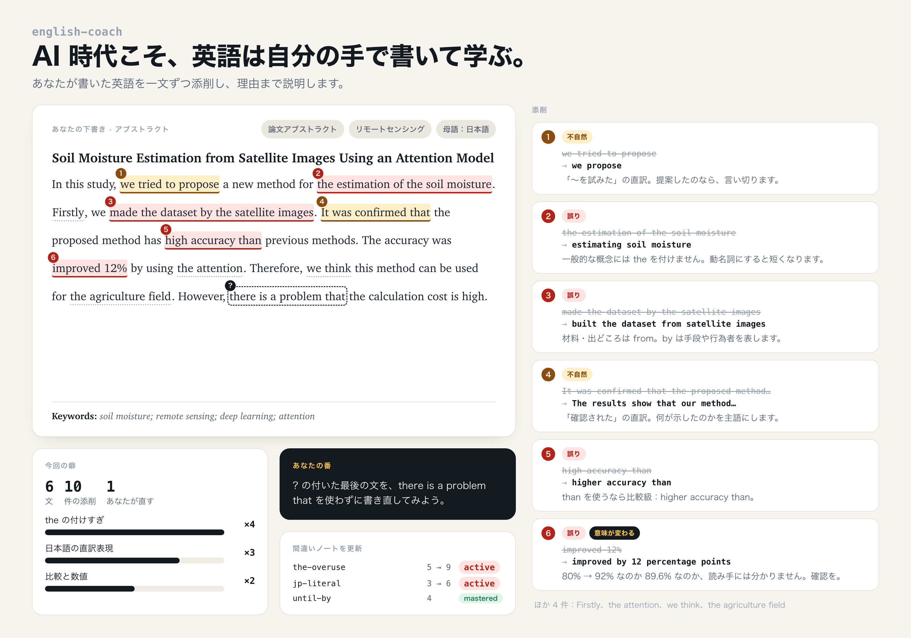
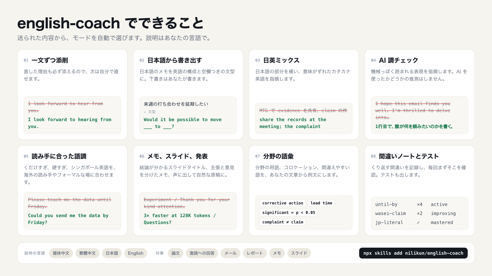

<div align="center">

[English](README.md) · [简体中文](README.zh-CN.md) · [繁體中文](README.zh-TW.md) · **日本語**

# english-coach

**AI 時代こそ、英語は自分の手で書いて学ぶ。**

自分で書いた英語を一文ずつ添削し、直す理由を日本語で説明する Agent Skill です。<br>
論文、論文メモ、発表スライド、レポート、仕事のメールに。日本語・中国語話者とシンガポールの書き手向けです。

[](LICENSE)
[](skills/english-coach/SKILL.md)
[](#インストール)



</div>

## なぜ作ったか

ChatGPT に頼めば英文メールは5秒で書けます。ただ、受け取った教授や査読者、取引先には案外気づかれます。書き出しは決まって "I hope this email finds you well"、形容詞は3つ並び、やたらと "delve into" する。しかも、そうやって100通送っても、次の1通を自分で書けるようにはなりません。

かといって、文法書と週1回の英会話レッスンで地道に、というのも仕事や研究と並行するには時間が足りません。

english-coach では、下書きはあなたが書きます。雑でかまいません。それを一文ずつ見て、間違いを直し、なぜそう直すのかを日本語で説明します。同じ間違いを来週くり返さないためです。同じ癖が3回目に出てきたら、答えは出さずにヒントだけ渡して、あなた自身に直してもらいます。

## インストール

Claude Code、Codex、Cursor など、skill に対応したエージェントに次の一文を送ってください。

```
Install the english-coach skill from https://github.com/nilikun/english-coach
```

コマンドラインからも入れられます。

```bash
npx skills add nilikun/english-coach
```

<details>
<summary>そのほかのインストール方法</summary>

**Claude Code プラグイン**

```
/plugin marketplace add nilikun/english-coach
/plugin install english-coach@english-coach
```

**手動**：`skills/english-coach` フォルダを丸ごと、エージェントの skills フォルダ（例：`~/.claude/skills/`）にコピーします。skill は `references/` 内のファイルも読むので、`SKILL.md` だけのコピーでは動きません。

**claude.ai**：[Releases](https://github.com/nilikun/english-coach/releases) から `english-coach.zip` をダウンロードし、Settings → Capabilities → Skills からアップロードします。

</details>

## 使い方

下書きを貼って、何の文章かを一言添えるだけです。コマンドを覚える必要はありません。たとえば：

```
海外の取引先に送るメールです。英語を見てください <下書き>
来週のゼミで使うスライドの英語をチェックして <スライドの文字>
この英語、不自然じゃないですか <一文>
```

名前で呼ぶこともできます：`/english-coach <下書き>`（Claude Code プラグインとして入れた場合は `/english-coach:english-coach`）。

## できること



送られた内容を見て、どのモードを使うかは skill が判断します。

| 送るもの | やること |
|---|---|
| 自分で書いた英語 | **一文ずつ添削**。直し方、理由、問題の種類（誤り・不自然・語調・AI 調）を示します。問題のない文には ✅ を付けます。 |
| 日本語の下書きやメモ、「何から書けばいいか分からない」 | **書き出しの手伝い**。英語での構成、キーワード、空欄つきの文型を渡します。あなたが埋めて書いたら、それを添削します。 |
| 「来週の MTG で、この件の evidence を共有します」のような日英まじり | **日英ミックス**。日本語部分の英語候補と違いを示します。*claim*、*evidence*、*fix*、*MTG* のように、英語のつもりで意味がずれているカタカナ語も指摘します。 |
| ChatGPT で書いた文章 | **AI 調チェック**。機械っぽく読まれる表現を指摘し、自分の言葉で言い直す手伝いをします。AI を使ったかどうかの推測はしません。 |
| 英語の論文メモ、スライド、発表原稿 | **メモと発表**。メモでは「論文の主張」と「自分の意見」を分けます。スライドは結論が分かるタイトルと、形のそろった箇条書きに。原稿は声に出して自然な英語にします。*Thank you for your kind attention* や *I will make a presentation about…* も直します。 |
| 「品質保証のメールでよく使う表現は？」 | **分野の語彙**。その分野の用語、コロケーション、間違えやすい語を、できるだけあなたの文章から例文を作って示します。 |
| 「テストして」 | **間違いノート**。くり返し出る間違いを記録し、毎回の添削でまずそこを確認します。あなた自身の間違いから問題も作ります。 |

急いでいるときは、そう伝えてください（「至急」「10分後に送ります」）。そのまま送れる修正版を先に出し、直すべき癖を3つだけ添えます。

## 例

日本の品質保証担当者が、海外の取引先に送ろうとしていたメールの一部です。

> We think the evidence is necessary, so please teach me the inspection data until this Friday.

english-coach の返信（抜粋）：

> - ⚠️ **「教えてください」の直訳** `oshiete`：*teach* は「授業をする・技術を教え込む」です。データは *send*、情報なら *tell me / let me know*。
> - ❌ **「までに」は by** `until-by`：*until Friday* は「金曜までずっと」。締め切りは *by Friday*。
> - ⚠️ **「エビデンス」** `wasei-evidence`：英語の *evidence* は裁判の「証拠」に聞こえます。ほしいのはデータそのものなので、言い換えずに *the inspection data* と書けば十分です。

全文（手を加えていない出力）：

| 例 | 説明の言語 |
|---|---|
| [海外の取引先へのメール](examples/ja-supplier-email.md) | 日本語 |
| [ドイツの提携先へのメール](examples/singapore-partner-email.md) | English |
| [論文のアブストラクト](examples/zh-CN-paper-abstract.md) | 简体中文 |
| [研究室ミーティングのスライドと発表原稿](examples/zh-CN-group-meeting-slides.md) | 简体中文 |
| [米国本社 PM への中英まじりのメッセージ](examples/zh-TW-mixed-message.md) | 繁體中文 |
| [ChatGPT で書いた博士課程の問い合わせメール](examples/zh-CN-ai-style-phd-email.md) | 简体中文 |

## 何を知っているか

**言語**：日本語、中国語（簡体字・繁体字。台湾と香港の言い回しにも対応）、シンガポール英語と Singlish。話しかけた言語で説明します。

**日本語話者によくある癖**：冠詞と単数・複数、主語の省略、和製英語（*claim*、*smart*、*tension*、*challenge*、*reform*）、決まり文句の直訳（*Please teach me*、*We will consider it*、*Thank you for your continued support* を毎回書く）、そしてメールの最後に埋もれたお願い。

**中国語話者によくある癖**：Felicia Brittman が中国の工学系大学院生の英語論文200本以上から抜き出した *The Most Common Habits from more than 200 English Papers written by Graduate Chinese Engineering Students* を元に、自分たちの言葉と新しい例文で整理し直しました。

**文章の種類**：論文、アブストラクト、学位論文、研究費の申請書、査読への回答、投稿時のカバーレター、論文メモ、輪講・ゼミ・学会のスライド、発表原稿と質疑応答、各種メール（依頼、催促、お断り、お詫び、エスカレーション、初めての連絡、研究室訪問の依頼）、週報、提案書、障害報告、議事録。

**業界**：ソフトウェア、AI・データ、金融、コンサルティング、監査、製造・サプライチェーン、医療・バイオ、法務、エンジニアリング、マーケティング、営業、人事、公共部門。論文の書き方から仕事の文書の書き方への切り替えも扱います。査読を通る書き方が、ビジネス文書ではかえって読みにくくなることがよくあるからです。

## 間違いノート

最初の添削のあとで、ノートを作るかどうかを一度だけ聞きます。作る場合は、手元の `~/.english-coach/notebook.md` に記録します。普通の markdown ファイルなので、自分で開いて編集もできます。

```markdown
| slug         | 癖                  | 回数 | 最後に出た日 | 例（あなたの文 → 修正）                  | 状態      |
|--------------|---------------------|------|-------------|------------------------------------------|-----------|
| until-by     | 期限に until        | 4    | 2026-10-19  | until this Friday → by this Friday       | active    |
| wasei-claim  | 苦情を claim        | 2    | 2026-10-12  | a claim from our customer → a complaint  | improving |
```

保存するのは短い抜粋だけで、人名・社名・金額は記号に置き換えます。「テストして」「復習」と言えば、あなた自身の間違いから5問作ります。

## 構成

```
skills/english-coach/
├── SKILL.md              # 方針、モードの選び方、セルフチェック
└── references/
    ├── review.md         # 一文ずつ添削の形式
    ├── scaffold.md       # 日本語・中国語からの書き出し
    ├── mixed-input.md    # 日英・中英ミックス、オフィス英語
    ├── register.md       # くだけすぎ・硬すぎ
    ├── de-ai.md          # AI 調
    ├── vocab.md          # 分野の語彙
    ├── notebook.md       # 間違いノートとテスト
    ├── l1/               # chinese, chinese-tw-hk, singapore, japanese
    └── genres/           # academic, email, report, industry, notes-and-slides
```

`SKILL.md` は短くしてあり、そのとき必要なファイルだけを読みます。短いメールのチェックで論文用のガイドまで読み込むことはありません。

## 今後の予定

- [ ] 韓国語
- [ ] ベトナム語、タイ語、インドネシア語、マレー語
- [ ] インド英語
- [ ] スペイン語、ポルトガル語、アラビア語、ドイツ語、フランス語の話者向け
- [ ] `examples/` に実際の添削例を追加
- [ ] 「見つけるべき問題」を付けたテストセット

欲しいものがあれば issue で教えてください。言語モジュールを自分で追加する方法は [CONTRIBUTING.md](CONTRIBUTING.md) にあります。

## クレジット

- Felicia Brittman, *The Most Common Habits from more than 200 English Papers written by Graduate Chinese Engineering Students*。中国語モジュールはこのリストを私たちの言葉でまとめ直したもので、原文の転載ではありません。
- AI 調のパターンは Peter Yang の [no-ai-slop](https://github.com/petergyang/no-ai-slop)（MIT）を参考にしています。

## ライセンス

[MIT](LICENSE)
