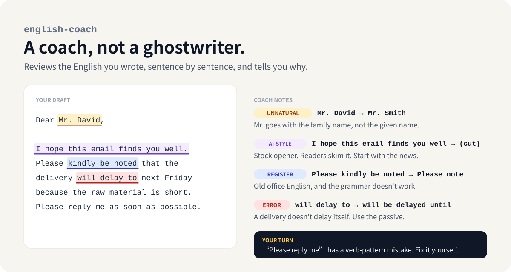

<div align="center">

**English** · [简体中文](README.zh-CN.md) · [繁體中文](README.zh-TW.md) · [日本語](README.ja.md)

# english-coach

**Learn to write English yourself, even with AI around.**

An agent skill that reviews the English you wrote and explains every fix in your own language.<br>
For papers, reading notes, slides, reports and work email. Built for Chinese, Japanese and Singaporean writers.

[](LICENSE)
[](skills/english-coach/SKILL.md)
[](#install)



</div>

## Why

ChatGPT can write your email in five seconds. Your professor, your reviewer and your client can often tell. AI drafts open with "I hope this email finds you well", list three adjectives where one would do, and "delve into" things. And after a hundred of those emails, you still can't write the next one yourself.

Learning the slow way, with grammar books and a tutor once a week, doesn't fit a working week either.

With english-coach, you write the draft, however rough. The skill goes through it sentence by sentence, fixes what's wrong, and tells you why in Chinese, Japanese or English, so the same mistake doesn't come back next week. When the same habit shows up a third time, it stops giving you the answer and asks you to fix it.

## Install

Paste this into Claude Code, Codex, Cursor or any agent that supports skills:

```
Install the english-coach skill from https://github.com/nilikun/english-coach
```

Or use the command line:

```bash
npx skills add nilikun/english-coach
```

<details>
<summary>Other ways to install</summary>

**Claude Code plugin**

```
/plugin marketplace add nilikun/english-coach
/plugin install english-coach@english-coach
```

**Manual**: copy the whole `skills/english-coach` folder (not just `SKILL.md`; the skill reads the files in `references/`) into your agent's skills folder, for example `~/.claude/skills/`.

**claude.ai**: download `english-coach.zip` from [Releases](https://github.com/nilikun/english-coach/releases) and upload it under Settings → Capabilities → Skills.

</details>

## Use

Paste your draft and say what it is. You don't need a command; the skill picks up requests like these:

```
Can you check this email to a supplier? <draft>
帮我看看这段摘要，下周要投稿 <draft>
海外の取引先へのメールです。英語を見てください <draft>
```

Or call it by name: `/english-coach <draft>` (as a Claude Code plugin: `/english-coach:english-coach`).

## What it does

It reads what you sent and picks the mode itself.

| You send | It does |
|---|---|
| English you wrote | **Review.** Sentence by sentence: the fix, the reason, and the type of problem (error, unnatural, register, AI-style). Sentences that are already right get a ✅. |
| Chinese or Japanese notes, or "I don't know how to start" | **Scaffold.** The English structure, the key terms, and sentence frames with blanks. You fill them in; then it reviews your draft. |
| A mix, like *we need to 确认 the 交期* | **Mixed.** Options for each Chinese or Japanese chunk and how they differ. It also flags office English that doesn't mean what you think: *push*, *case*, *claim*, *evidence*. |
| Text drafted with ChatGPT | **AI-style check.** Names the phrases that make it read machine-written and helps you say it in your own words. It never guesses whether you used AI. |
| Singlish or chat-style English for a formal reader | **Register.** *Pls revert*, *can or not*, *noted with thanks* turned into wording an overseas reader understands. It treats Singlish as a real variety and changes it only for overseas or formal readers. |
| Paper notes, slides or a talk script in English | **Notes and slides.** Notes that separate what the paper claims from what you think; slide titles that state the point; bullets in parallel form; a script that sounds spoken, with fixes for *Thank you for your listening* and *Welcome everyone to criticize and correct*. |
| "What words do I need for supply-chain email?" | **Vocab.** A short list of terms, collocations and traps for your field, with examples built from your own text. |
| "Quiz me" | **Notebook.** It keeps a file of your recurring mistakes, checks them first in each review, and quizzes you on them. |

If you're in a hurry, say so ("急", "至急", "need to send this in 10 minutes") and you get the corrected text first, then the three habits worth fixing.

## Example

A Singaporean writer sent this line in an email to a new partner in Germany:

> Pls revert by this Fri if can extend to end Q2.

Part of the skill's reply:

> **→** Could you let us know by Friday, 23 October, whether the deadline can be extended to the end of Q2?
> - 🗣️ **"revert"** `revert`: this is the most important fix. In UK and US English, *revert* means "go back to an earlier state", so Klaus may read *Pls revert* as "please undo it". Use *let us know*, *reply* or *get back to us*.
> - ❌ **"if" vs "whether"** `if-whether`: *Please reply by Friday if you can extend* can be read as "reply only if the answer is yes". *Let us know whether…* asks for an answer either way.
> - 🗣️ **Too blunt** `too-blunt`: a bare imperative (*Pls revert*) reads as an order to a European reader. One softener (*Could you…*) is enough, and sentence ③ already gives your reason.

Full, unedited replies:

| Example | Language of the explanations |
|---|---|
| [Email to a partner in Germany](examples/singapore-partner-email.md) (Singlish → international English) | English |
| [Group meeting slides and talk script](examples/zh-CN-group-meeting-slides.md) | 简体中文 |
| [Journal abstract](examples/zh-CN-paper-abstract.md) (catches *3.2% higher* that should be *3.2 percentage points*) | 简体中文 |
| [ChatGPT-drafted PhD inquiry](examples/zh-CN-ai-style-phd-email.md) | 简体中文 |
| [Mixed Chinese-English message to US headquarters](examples/zh-TW-mixed-message.md) | 繁體中文 |
| [Email to an overseas supplier](examples/ja-supplier-email.md) | 日本語 |
| [Delay notice to a client, sending tomorrow](examples/zh-CN-client-email.md) | 简体中文 |
| [PhD inquiry from scratch: "I don't know how to start"](examples/zh-CN-phd-email-scaffold.md) | 简体中文 |

## What it knows

**Languages.** Simplified Chinese (Mainland), Traditional Chinese (Taiwan and Hong Kong, with regional wording), Japanese, and Singapore English and Singlish. Explanations come in the language you write to it in.

**Chinese habits.** The core list comes from Felicia Brittman's guide, *The Most Common Habits from more than 200 English Papers written by Graduate Chinese Engineering Students*, which Chinese graduate students have passed around since the 2000s: missing articles, 60-word sentences, *by this way*, *respectively* in the wrong place, *obviously*, and the rest. We summarized it in our own words with new examples, then added what's common now: *With the development of…*, *realize* for 实现, *push* for 催, full-width punctuation.

**Japanese habits.** Articles and plurals, wasei-eigo (*claim*, *smart*, *tension*, *challenge*), literal set phrases (*Please teach me*, *We will consider it*), and the request buried at the end of the email.

**Writing types.** Research papers, abstracts, theses, grant proposals, reviewer responses, letters to editors, paper-reading notes, journal club and group meeting slides, talk scripts and Q&A, emails of every kind (request, follow-up, decline, apology, escalation, cold outreach), status reports, proposals, post-mortems, meeting minutes, slide titles.

**Fields.** Software, AI and data, finance, consulting, audit, manufacturing and supply chain, healthcare and biomedicine, legal, engineering, marketing, sales, HR and public sector. It also covers the switch from academic to industry writing, where habits that pass peer review make a business memo hard to read.

## Error notebook

After your first review, the skill asks whether you want a notebook. If you say yes, it keeps `~/.english-coach/notebook.md`, a plain markdown file you can read and edit:

```markdown
| slug    | habit           | count | last seen  | example (yours → fix)                         | status    |
|---------|-----------------|-------|------------|-----------------------------------------------|-----------|
| article | missing article | 7     | 2026-10-19 | on surface of the film → on the surface of…   | active    |
| realize | realize for 实现 | 2     | 2026-10-12 | realize the function → implement the function | improving |
```

It stores short snippets only, and replaces names, companies and amounts with placeholders. Say "quiz me" to get five exercises built from your own mistakes.

## How it's built

```
skills/english-coach/
├── SKILL.md              # principles, routing, self-check
└── references/
    ├── review.md         # sentence-by-sentence format
    ├── scaffold.md       # sentence frames from your native language
    ├── mixed-input.md    # mixed drafts and drifted office English
    ├── register.md       # too casual / too stiff
    ├── de-ai.md          # AI-style patterns
    ├── vocab.md          # field vocabulary
    ├── notebook.md       # error notebook and quizzes
    ├── l1/               # chinese, chinese-tw-hk, singapore, japanese
    └── genres/           # academic, email, report, industry, notes-and-slides
```

`SKILL.md` stays short and loads only the files a request needs, so a quick email check doesn't read the whole academic guide.

## Roadmap

- [ ] Korean
- [ ] Vietnamese, Thai, Indonesian and Malay
- [ ] Indian English
- [ ] Spanish, Portuguese, Arabic, German and French speakers
- [ ] More real before-and-after examples in `examples/`
- [ ] An eval set with expected issues per test case

To ask for one, open an issue. To add a language module yourself, see [CONTRIBUTING.md](CONTRIBUTING.md).

## Credits

- Felicia Brittman, *The Most Common Habits from more than 200 English Papers written by Graduate Chinese Engineering Students*. The Chinese module is our summary of her list, not a copy.
- The AI-style patterns build on [no-ai-slop](https://github.com/petergyang/no-ai-slop) by Peter Yang (MIT).

## License

[MIT](LICENSE)
