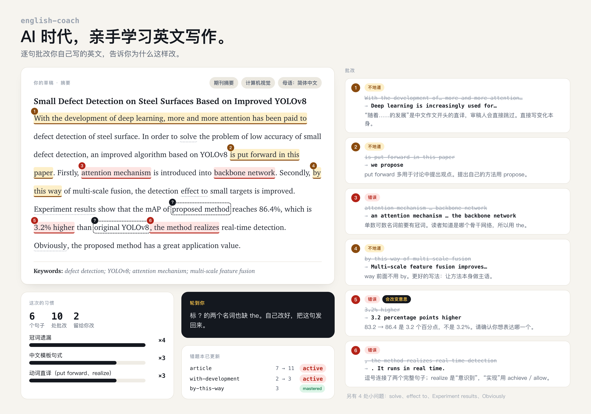
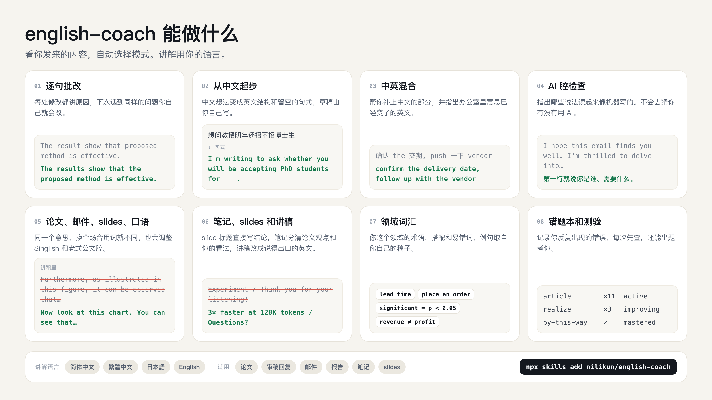

<div align="center">

[English](README.md) · **简体中文** · [繁體中文](README.zh-TW.md) · [日本語](README.ja.md)

# english-coach

**AI 时代，亲手学习英文写作。**

一个 Agent Skill：逐句批改你自己写的英文，用中文告诉你每处为什么要改。<br>
适合写论文、读书笔记、组会 slides、报告和工作邮件。专门针对中文、日文母语者和新加坡用户。

[](LICENSE)
[](skills/english-coach/SKILL.md)
[](#安装)



</div>

## 为什么做这个

让 ChatGPT 写一封英文邮件只要五秒，但导师、审稿人和客户往往一眼就能看出来：开头一定是 "I hope this email finds you well"，形容词一用就是三个，动不动就 "delve into"。更麻烦的是，这样的邮件发了一百封，下一封还是不会自己写。

可是像以前那样啃语法书、每周上一次外教课，上班族和研究生又没那个时间。

english-coach 的做法是：草稿你自己写，写得再粗糙都行。它逐句帮你看，改掉错的地方，再用中文讲清楚为什么，让同一个错误下周不再出现。同一个问题出现第三次时，它就不直接给答案了，换你自己来改。

## 安装

把下面这句话发给 Claude Code、Codex、Cursor 或其他支持 skill 的 agent：

```
Install the english-coach skill from https://github.com/nilikun/english-coach
```

或者用命令行：

```bash
npx skills add nilikun/english-coach
```

<details>
<summary>其他安装方式</summary>

**Claude Code 插件**

```
/plugin marketplace add nilikun/english-coach
/plugin install english-coach@english-coach
```

**手动安装**：把整个 `skills/english-coach` 文件夹复制到 agent 的 skills 目录，比如 `~/.claude/skills/`。注意要复制整个文件夹，不能只复制 `SKILL.md`，因为 skill 会读 `references/` 里的文件。

**claude.ai**：从 [Releases](https://github.com/nilikun/english-coach/releases) 下载 `english-coach.zip`，在 Settings → Capabilities → Skills 里上传。

</details>

## 怎么用

把草稿贴进去，说一句这是什么就行。不用记命令，下面这些说法都会触发它：

```
帮我看看这段摘要，下周要投稿 <草稿>
明天要发给客户，帮我改改 <草稿>
这句英文自然吗 <句子>
```

也可以直接叫它：`/english-coach <草稿>`（以 Claude Code 插件安装时是 `/english-coach:english-coach`）。

## 它能做什么



它会看你发来的内容，自己判断用哪种模式。

| 你发的是 | 它会 |
|---|---|
| 自己写的英文 | **逐句批改**。每句给出改法、原因和问题类型（错误、不地道、语体不对、AI 腔）。写对的句子打 ✅。 |
| 中文草稿、提纲，或者"完全不知道怎么开头" | **起步**。给出英文的结构、关键词和留空的句式，你自己填完，它再帮你批改。 |
| 中英混杂，比如 *we need to 确认 the 交期* | **混合输入**。每个中文词给几个英文选项并说明区别。还会指出那些在办公室里意思已经变了的英文词：*push*、*case*、*align*、*open a meeting*。 |
| 用 ChatGPT 写的稿子 | **AI 腔检查**。指出哪些说法一看就像 AI 写的，帮你换成自己的话。它不会去猜你有没有用 AI。 |
| 新加坡式英语、聊天口吻 | **语体调整**。把 *Pls revert*、*can or not*、*noted with thanks* 改成海外读者看得懂的说法。Singlish 是一种正当的英语变体，只有读者在海外或者场合正式时才需要改。 |
| 想把论文改成讲稿或 slides，或者讲稿听起来像在念论文 | **媒介**。论文、邮件、聊天、slides、口语，用词各不相同：论文里写 *however*，讲出来说 *but*；书面写 *approximately 48%*，口头说 *almost half*；slide 上可以写 *↓ 48%*，邮件里不行。它能在这些之间帮你转换，边改边讲规则。 |
| 英文的论文笔记、slides 或讲稿 | **笔记和汇报**。笔记里分清"论文说的"和"你认为的"；slide 标题直接写结论，要点句式保持一致；讲稿改成真正能说出口的英文，*Thank you for your listening*、*Welcome everyone to criticize and correct* 这类句子也会帮你换掉。 |
| "供应链邮件常用哪些词？" | **领域词汇**。给你这个领域的术语、搭配和容易用错的词，例句尽量从你自己的稿子里取。 |
| "出几道题考考我" | **错题本**。记录你反复出现的问题，每次批改先查这些，还能拿你自己的错误出题。 |

赶时间就直接说（"急"、"十分钟后要发"），它会先给你能直接复制的改好的版本，再列出最该改的三个习惯。

## 示例

一篇投稿摘要里有这么一句：

> Experiment results show that the mAP of proposed method reaches 86.4%, which is 3.2% higher than original YOLOv8, …

english-coach 的回复（节选）：

> - ❌ **百分比 vs 百分点** `percentage-point`：**这条会改变意思，请先确认。** 如果是 86.4% 减去 83.2% 得到的 3.2，英文要写 *3.2 percentage points higher*；写 *3.2% higher* 意思是相对提升 3.2%（即原来约 83.7%）。
> - ❌ **"实现"** `realize`：*realize* 主要是"意识到"。"实现实时检测"用 *achieve* 或 *allow*。
> - ❌ **逗号连句** `comma-splice`：*…92 FPS, the method realizes…* 是两个完整句子用逗号连起来，英文里这是语法错误。在 *YOLOv8* 后断句，后半句另起。

完整回复，原样未改：

| 示例 | 讲解语言 |
|---|---|
| [论文摘要](examples/zh-CN-paper-abstract.md) | 简体中文 |
| [把论文段落改成 slides 和讲稿](examples/zh-CN-paper-to-talk.md) | 简体中文 |
| [邮件里混进了 PPT 写法的周报](examples/zh-CN-weekly-report.md) | 简体中文 |
| [像在念论文的学会发表讲稿](examples/ja-conference-talk.md) | 日本語 |
| [组会 slides 和讲稿](examples/zh-CN-group-meeting-slides.md) | 简体中文 |
| [用 ChatGPT 写的套磁信](examples/zh-CN-ai-style-phd-email.md) | 简体中文 |
| [明天要发的延期通知](examples/zh-CN-client-email.md) | 简体中文 |
| [不知道怎么开头的套磁信（起步模式）](examples/zh-CN-phd-email-scaffold.md) | 简体中文 |
| [中英混杂、写给美国总部的消息](examples/zh-TW-mixed-message.md) | 繁體中文 |
| [写给海外供应商的邮件](examples/ja-supplier-email.md) | 日本語 |
| [写给德国合作方的邮件](examples/singapore-partner-email.md) | English |

## 它知道些什么

**语言**：简体中文（中国大陆）、繁体中文（台湾、香港，讲解时用当地用语，比如"資訊""軟體"）、日文、新加坡英语和 Singlish。你用什么语言跟它说话，它就用什么语言讲解。

**中文母语者的常见问题**：核心清单来自 Felicia Brittman 的 *The Most Common Habits from more than 200 English Papers written by Graduate Chinese Engineering Students*，很多研究生应该都在群里见过。冠词缺失、60 词的长句、*by this way*、*respectively* 放错位置、*obviously* 等，都在里面。我们用自己的话重新整理，换了新例句，又补上了现在常见的问题：*With the development of…* 开头、把"实现"写成 *realize*、把"催一下"写成 *push*、全角标点混进英文。

**文体**：期刊论文、摘要、学位论文、基金申请、审稿回复、给编辑的投稿信、论文阅读笔记、组会和 journal club 的 slides、讲稿和问答、各类邮件（请求、跟进、拒绝、道歉、升级、陌生开发、套磁）、周报、提案、事故复盘、会议纪要、PPT 标题。

**行业**：软件、AI 与数据、金融、咨询、审计、制造与供应链、医疗与生物医药、法律、工程、市场、销售、HR、公共部门。也讲从学术写作到业界写作的转变：能过审稿的写法，放在商业备忘录里往往让人读不下去。

## 错题本

第一次批改完，它会问你要不要建错题本。同意的话，它会在本地维护 `~/.english-coach/notebook.md`，一个可以直接打开、手动修改的 markdown 文件：

```markdown
| slug    | 习惯              | 次数 | 最近一次    | 例子（你的 → 改法）                              | 状态      |
|---------|-------------------|------|------------|--------------------------------------------------|-----------|
| article | 冠词遗漏          | 7    | 2026-10-19 | on surface of the film → on the surface of…      | active    |
| realize | realize 当"实现"  | 2    | 2026-10-12 | realize the function → implement the function    | improving |
```

只记短句片段，人名、公司名和金额会替换成占位符。说"出题"或"复习错题"，它会用你自己的错误出 5 道题。

## 结构

```
skills/english-coach/
├── SKILL.md              # 原则、路由、自检
└── references/
    ├── review.md         # 逐句批改的格式
    ├── scaffold.md       # 从中文 / 日文起步的句式
    ├── mixed-input.md    # 中英混杂、办公室英文
    ├── register.md       # 太口语 / 太生硬
    ├── medium.md         # 论文 / 邮件 / 聊天 / slides / 口语
    ├── de-ai.md          # AI 腔
    ├── vocab.md          # 领域词汇
    ├── notebook.md       # 错题本和测验
    ├── l1/               # chinese, chinese-tw-hk, singapore, japanese
    └── genres/           # academic, email, report, industry, notes-and-slides
```

`SKILL.md` 本身很短，只加载当前请求需要的文件。检查一封短邮件时，不会把整份论文指南都读一遍。

## 计划

- [ ] 韩语
- [ ] 越南语、泰语、印尼语和马来语
- [ ] 印度英语
- [ ] 西班牙语、葡萄牙语、阿拉伯语、德语、法语母语者
- [ ] 在 `examples/` 里加更多真实的前后对比
- [ ] 一套标注了"应该找出哪些问题"的测试集

想要哪个，开个 issue 告诉我们。想自己加一种语言，看 [CONTRIBUTING.md](CONTRIBUTING.md)。

## 致谢

- Felicia Brittman, *The Most Common Habits from more than 200 English Papers written by Graduate Chinese Engineering Students*。中文模块是我们对这份清单的重新整理，不是原文照搬。
- AI 腔清单参考了 Peter Yang 的 [no-ai-slop](https://github.com/petergyang/no-ai-slop)（MIT）。

## 许可

[MIT](LICENSE)
