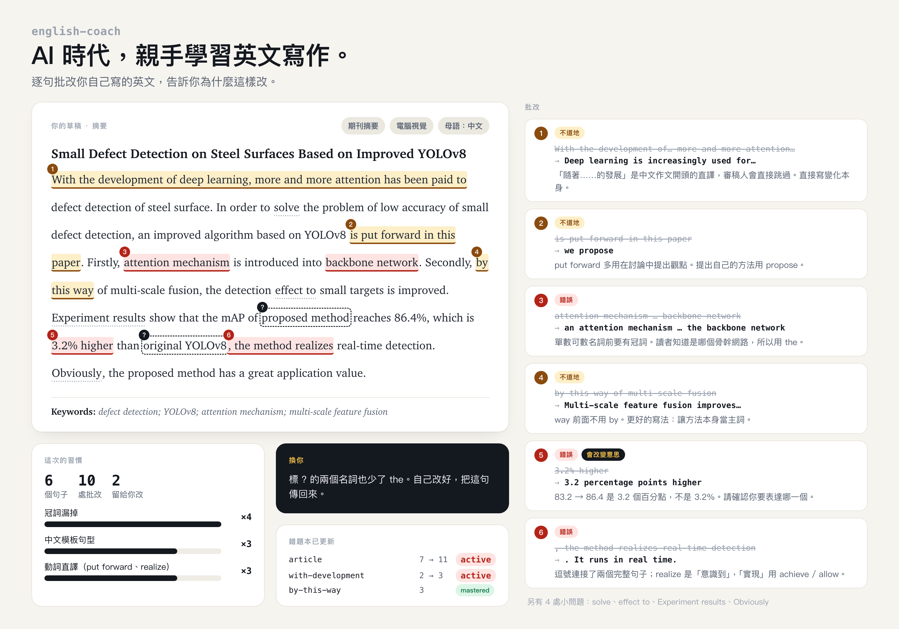
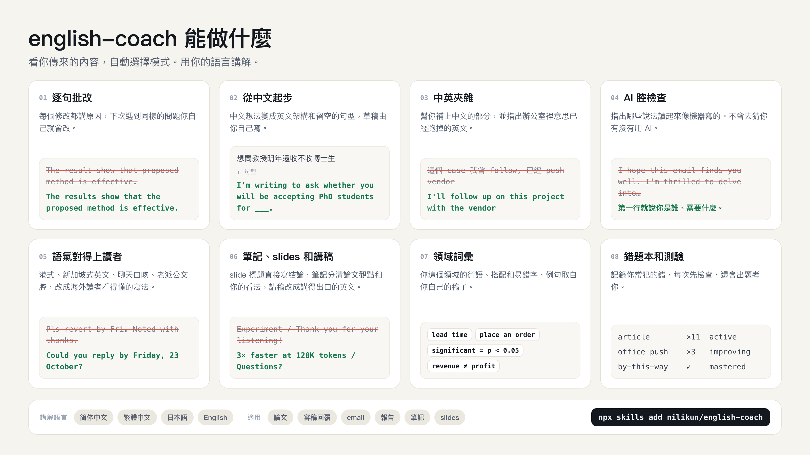

<div align="center">

[English](README.md) · [简体中文](README.zh-CN.md) · **繁體中文** · [日本語](README.ja.md)

# english-coach

**AI 時代，親手學習英文寫作。**

一個 Agent Skill：逐句批改你自己寫的英文，用中文告訴你每個地方為什麼要改。<br>
適合寫論文、讀書筆記、書報討論的 slides、報告和工作 email。專為中文、日文母語者和新加坡使用者設計。

[](LICENSE)
[](skills/english-coach/SKILL.md)
[](#安裝)



</div>

## 為什麼要做這個

叫 ChatGPT 寫一封英文 email 只要五秒，但教授、審稿人和客戶常常一眼就看得出來：開頭一定是 "I hope this email finds you well"，形容詞一次放三個，動不動就 "delve into"。更麻煩的是，這種信寄了一百封，下一封還是不會自己寫。

可是像以前那樣啃文法書、每週上一次家教課，上班族和研究生也沒那個時間。

english-coach 的做法是：草稿你自己寫，寫得再粗糙都沒關係。它一句一句幫你看，改掉錯的地方，再用中文講清楚為什麼，讓同一個錯誤下週不會再出現。同一個問題第三次出現時，它就不直接給答案了，換你自己改改看。

## 安裝

把下面這句話傳給 Claude Code、Codex、Cursor 或其他支援 skill 的 agent：

```
Install the english-coach skill from https://github.com/nilikun/english-coach
```

或是用指令列：

```bash
npx skills add nilikun/english-coach
```

<details>
<summary>其他安裝方式</summary>

**Claude Code 外掛**

```
/plugin marketplace add nilikun/english-coach
/plugin install english-coach@english-coach
```

**手動安裝**：把整個 `skills/english-coach` 資料夾複製到 agent 的 skills 目錄，例如 `~/.claude/skills/`。要複製整個資料夾，不能只複製 `SKILL.md`，因為 skill 會讀 `references/` 裡的檔案。

**claude.ai**：到 [Releases](https://github.com/nilikun/english-coach/releases) 下載 `english-coach.zip`，在 Settings → Capabilities → Skills 上傳。

</details>

## 怎麼用

把草稿貼進去，說一句這是什麼就好。不用記指令，像這樣講就會啟動：

```
幫我看一下這封要寄給客戶的 email <草稿>
這段 abstract 下週要投稿，英文可以嗎 <草稿>
這句英文自然嗎 <句子>
```

也可以直接叫它：`/english-coach <草稿>`（用 Claude Code 外掛安裝的話是 `/english-coach:english-coach`）。

## 它能做什麼



它會看你傳來的內容，自己判斷要用哪種模式。

| 你傳的是 | 它會 |
|---|---|
| 自己寫的英文 | **逐句批改**。每句給改法、原因和問題類型（錯誤、不道地、語氣不對、AI 腔）。寫對的句子打 ✅。 |
| 中文草稿、大綱，或是「不知道怎麼開頭」 | **起步**。給你英文的段落順序、關鍵字和留空的句型，你自己填完，它再幫你批改。 |
| 中英夾雜，例如「這個 case 我們會 follow，已經 push vendor 了」 | **中英混合**。每個中文詞給幾個英文選項並說明差別。也會指出那些在辦公室裡意思已經跑掉的英文：*push*、*case*、*follow*、*open a meeting*。 |
| 用 ChatGPT 寫的稿子 | **AI 腔檢查**。指出哪些說法一看就像 AI 寫的，幫你換成自己的話。它不會去猜你有沒有用 AI。 |
| 港式、新加坡式英文或聊天口吻 | **語氣調整**。把 *Pls revert*、*Noted with thanks*、*I will send you later* 改成海外讀者看得懂的寫法。這些在當地是正常用法，只有讀者在海外或場合正式時才需要改。 |
| 英文的論文筆記、slides 或講稿 | **筆記和報告**。筆記裡分清楚「論文說的」和「你自己的看法」；slide 標題直接寫結論，條列的句型保持一致；講稿改成真的講得出口的英文，像 *Thank you for your listening* 這種句子也會幫你換掉。 |
| 「供應鏈 email 常用哪些字？」 | **領域詞彙**。給你這個領域的術語、搭配和容易用錯的字，例句盡量取自你自己的稿子。 |
| 「出幾題考我」 | **錯題本**。記錄你常犯的錯，每次批改先查這些，還會用你自己的錯誤出題。 |

趕時間就直接講（「急」、「十分鐘後要寄」），它會先給你可以直接複製的版本，再列出最該改的三個習慣。

## 範例

一位台灣工程師要寄給美國總部 PM 的訊息：

> Hi Kevin，這個 case 我們這邊會 follow，目前卡在 vendor 那邊的 交期，我已經 push 他們了……

english-coach 的回覆（節錄）：

> | 原文 | 改成 | 為什麼 |
> |---|---|---|
> | 我已經 **push** 他們了 | *I've followed up with them* | 在美國同事耳中，*push* 有施壓、硬逼的意思，寫給總部看會像你在逼廠商。想表達「催」，用 *follow up with* 或 *remind*。 |
> | 我們 **open** 一個 meeting？ | *Would you have time for a meeting?* | 英文沒有 *open a meeting* 這種說法，要說 *set up / schedule a meeting*。 |

完整回覆，未經修改：

| 範例 | 講解語言 |
|---|---|
| [中英夾雜、寄給美國總部的訊息](examples/zh-TW-mixed-message.md) | 繁體中文 |
| [論文 abstract](examples/zh-CN-paper-abstract.md) | 简体中文 |
| [組會 slides 和講稿](examples/zh-CN-group-meeting-slides.md) | 简体中文 |
| [用 ChatGPT 寫的博士申請信](examples/zh-CN-ai-style-phd-email.md) | 简体中文 |
| [明天要寄的延遲通知](examples/zh-CN-client-email.md) | 简体中文 |
| [不知道怎麼開頭的博士申請信（起步模式）](examples/zh-CN-phd-email-scaffold.md) | 简体中文 |
| [寄給海外供應商的 email](examples/ja-supplier-email.md) | 日本語 |
| [寄給德國合作夥伴的 email](examples/singapore-partner-email.md) | English |

## 它懂哪些東西

**語言**：簡體中文（中國大陸）、繁體中文（台灣、香港，講解時用當地用語，像是「資訊」「軟體」「專案」）、日文、新加坡英文和 Singlish。你用什麼語言跟它講，它就用什麼語言講解。香港用英式拼字，台灣多半用美式，它不會硬改，只會檢查前後一致。

**中文母語者的常見問題**：核心清單來自 Felicia Brittman 的 *The Most Common Habits from more than 200 English Papers written by Graduate Chinese Engineering Students*，分析了兩百多篇中國工科研究生的英文論文。冠詞漏掉、60 個字的長句、*by this way*、*respectively* 放錯位置、*obviously* 等等都在裡面。我們用自己的話重新整理，換了新例句，也補上現在常見的問題：*With the development of…* 開頭、把「實現」寫成 *realize*、Wish you have a nice day、全形標點混進英文。

**台灣和香港的寫法**：「辛苦了」「麻煩你」「不好意思」的直譯，港式公文腔的 *Please be reminded*、*revert*、*chop*，都有專門整理。

**文體**：期刊論文、abstract、學位論文、研究計畫、審稿回覆、投稿信、論文閱讀筆記、書報討論和 lab meeting 的 slides、講稿和 Q&A、各類 email（請求、追蹤、婉拒、道歉、升級處理、陌生開發、申請博士）、週報、提案、事故檢討、會議紀錄。

**產業**：軟體、AI 與資料、金融、顧問、審計、製造與供應鏈、醫療與生醫、法律、工程、行銷、業務、人資、公部門。也會講從學術寫作轉到業界寫作要改什麼：能通過審稿的寫法，放進商業備忘錄常常讓人讀不下去。

## 錯題本

第一次批改完，它會問你要不要開一本錯題本。同意的話，它會在你的電腦裡維護 `~/.english-coach/notebook.md`，一個可以直接打開、手動修改的 markdown 檔：

```markdown
| slug        | 習慣              | 次數 | 最近一次    | 例子（你的 → 改法）                     | 狀態      |
|-------------|-------------------|------|------------|------------------------------------------|-----------|
| article     | 冠詞漏掉          | 7    | 2026-10-19 | on surface of → on the surface of        | active    |
| office-push | push 當「催」     | 2    | 2026-10-12 | I pushed the vendor → I followed up with | improving |
```

只記短句片段，人名、公司名和金額會換成代號。說「出題」或「複習錯題」，它會用你自己的錯誤出 5 題。

## 結構

```
skills/english-coach/
├── SKILL.md              # 原則、判斷流程、自我檢查
└── references/
    ├── review.md         # 逐句批改的格式
    ├── scaffold.md       # 從中文 / 日文起步的句型
    ├── mixed-input.md    # 中英夾雜、辦公室英文
    ├── register.md       # 太口語 / 太生硬
    ├── de-ai.md          # AI 腔
    ├── vocab.md          # 領域詞彙
    ├── notebook.md       # 錯題本和測驗
    ├── l1/               # chinese, chinese-tw-hk, singapore, japanese
    └── genres/           # academic, email, report, industry, notes-and-slides
```

`SKILL.md` 本身很短，只載入這次需要的檔案。看一封短 email 時，不會把整份論文指南都讀一遍。

## 接下來

- [ ] 韓文
- [ ] 越南文、泰文、印尼文和馬來文
- [ ] 印度英文
- [ ] 西班牙文、葡萄牙文、阿拉伯文、德文、法文母語者
- [ ] 在 `examples/` 加更多真實的前後對照
- [ ] 一套標好「應該找出哪些問題」的測試集

想要哪一個，開個 issue 告訴我們。想自己加一種語言，請看 [CONTRIBUTING.md](CONTRIBUTING.md)。

## 致謝

- Felicia Brittman, *The Most Common Habits from more than 200 English Papers written by Graduate Chinese Engineering Students*。中文模組是我們對這份清單的重新整理，不是照抄原文。
- AI 腔清單參考了 Peter Yang 的 [no-ai-slop](https://github.com/petergyang/no-ai-slop)（MIT）。

## 授權

[MIT](LICENSE)
